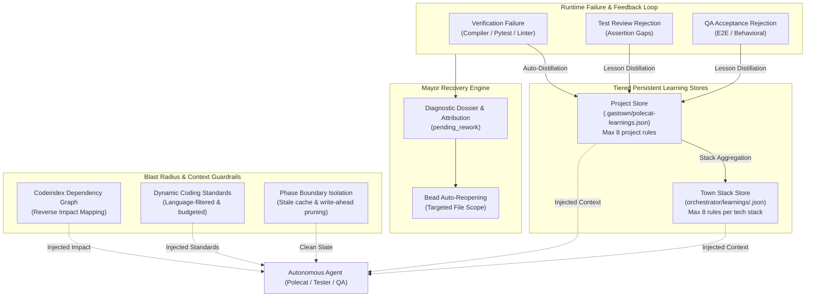

# Continuous Agent Learning & Feedback Architecture

---

## 1. Executive Summary

In multi-agent autonomous software delivery, agents must not repeat mistakes across iterative phases, rework cycles, or new project rigs. Monolithic prompt-based systems suffer from context amnesia: once an execution turn or session ends, lessons learned from build failures, test mismatches, and QA rejections are lost.

Gas Town solves this through a **multi-tiered continuous learning, feedback, and blast-radius awareness architecture**. This system captures concise, authoritative rules at runtime and injects them dynamically into agent prompts across five specialized mechanisms:



---

## 2. Tiered Persistent Learning Stores (`polecat_learnings`)

Agent lessons are stored in structured JSON ring-buffers designed to persist across session restarts, compaction, and new rig instantiations without blowing prompt token budgets.

### Learning Store Tiers

| Tier | File Path | Scope & Retention |
|:---|:---|:---|
| **Project-Scoped** | `{rig}/mayor/rig/.gastown/polecat-learnings.json` | Persists across all beads and delivery phases of the specific rig (`max 8` rules). |
| **Town-Scoped Stack Store** | `{townRoot}/orchestrator/learnings/<stack>.json` | Shared across all rigs using the same technology stack (e.g. `python.json`, `typescript.json`, `go.json`, `docker.json`). |

### Automated Rule Capture Mechanisms
1. **Verification Auto-Distillation**: When an agent encounters a command failure (e.g., `ModuleNotFoundError: No module named 'app'`) and subsequently fixes the issue, `gt-agent` automatically distils a single-line rule into the store.
2. **Review Rework Extraction**: When `test_review` or `qa_review` rejects a deliverable and the rework is subsequently verified green, the core lesson is extracted and added to the learning store.
3. **Explicit Agent Directives**: An agent can emit an explicit `LEARN: <one-line rule>` or `LEARN[stack]: <rule>` instruction during implementation turns.
4. **Outcome JSON Integration**: Agents can supply `"learning": "..."` or `"learnings": [...]` directly in terminal outcome payloads.

### Ring-Buffer Eviction & Context Budgeting
- **Strict Size Bounds**: Each learned rule is normalized to a single line capped at 140 characters.
- **Frequency Weighting (`hits`)**: Repeated occurrences of an existing rule increment its `hits` counter and refresh `updated_at`. When the store reaches the 8-entry limit, the oldest entry with the lowest hit count is evicted.
- **Prompt Budget Cap**: Injected learning context is filtered to active stacks only and capped at a maximum of **800 bytes** to prevent context window bloat.

### Live Example (`.gastown/polecat-learnings.json`)
```json
{
  "version": 1,
  "entries": [
    {
      "stack": "python",
      "rule": "Avoid in __init__.py: E ModuleNotFoundError: No module named 'app'",
      "source": "verify_fix",
      "bead_path": "finally/backend/app/api/__init__.py",
      "hits": 2,
      "updated_at": "2026-11-21T11:05:33Z"
    },
    {
      "stack": "python",
      "rule": "Avoid in schemas.py: E ModuleNotFoundError: No module named 'app'",
      "source": "verify_fix",
      "bead_path": "finally/backend/app/api/schemas.py",
      "hits": 3,
      "updated_at": "2026-11-25T15:55:16Z"
    },
    {
      "stack": "python",
      "rule": "Test review lesson: Root cause: phase verify fails at docker build in finally/ before pytest runs — preserve subshell directory context",
      "source": "qa_rework",
      "hits": 4,
      "updated_at": "2026-11-26T18:44:27Z"
    }
  ]
}
```

---

## 3. Mayor Recovery Engine & Targeted Rework Feedback

When quality gates fail, Gas Town does not discard work or prompt blindly. The **Mayor Recovery Engine** acts as an autonomous diagnostic supervisor:

1. **Structured Diagnostic Dossiers (`pending_rework`)**:
   - The orchestrator captures verbatim error streams, failed test excerpts, line numbers, and exit codes.
2. **Root-Cause Attribution**:
   - Rather than bouncing work back indiscriminately, Mayor categorizes the failure:
     - `planner_rework` (missing dependencies, unblocked ordering issues)
     - `architect_rework` (structural design or port conflicts)
     - `tester_rework` (test plan gaps or unasserted contracts)
     - `implementation_rework` (code syntax, logic, or runtime errors)
     - `qa_rework` (acceptance test failures)
3. **Targeted Bead Re-Opening**:
   - Only the exact beads owning the failed files (e.g. `te-44z` for schema validation) are re-opened. The implementer receives an isolated rework queue rather than a monolithic repository task.

---

## 4. Codeindex Blast-Radius Awareness

As an application grows across delivery phases, changes in Phase 5 must not unknowingly break foundations laid in Phase 1 or 2:

- **Reverse Dependency Analysis (`codeindex analyze`)**:
  - The AST and symbol dependency graph is analyzed and cached in `codeindex.json`.
- **Implement Context Injection**:
  - When an agent is assigned to modify or extend a file, `gt-agent` injects the **Codeindex Impact Analysis**, showing which downstream files and tests depend on the symbols being edited.
- **Regression Prevention**:
  - Informs the agent of critical consumers before code is written, ensuring backwards compatibility across interface changes.

---

## 5. Phase Boundary Isolation & Clean State Pruning

To maintain deterministic repeatability:

- **`prune_stale_layout_files`**:
  - Before starting an implementation phase, intermediate compilation artifacts (`.next/`, `out/`, `__pycache__/`, `.pytest_cache/`) are purged to ensure the new phase builds cleanly from genuine source files.
- **Anti-Write-Ahead Isolation**:
  - Deliverables belonging to future phases are isolated so that agents cannot "cheat" by writing ahead or depending on unverified future stubs.
- **Atomic Git Checkpoints**:
  - Every state transition is recorded as an atomic checkpoint commit:
    ```text
    chore(orchestrator): checkpoint <from_state> -> <to_state> (<outcome>) [wf-id]
    ```
    allowing immediate rollback or inspection if a regression occurs.

---

## 6. Dynamic Context-Budgeted Coding Standards

Static, massive coding standard files overwhelm LLM attention. Gas Town implements dynamic, language-scoped standards filtering:

- **Language Stack Detection**: The active bead's file extension (`.py`, `.ts`, `.go`, `.sql`, `Dockerfile`) selects only the relevant standard file (`standards/python.md`, `standards/typescript.md`, `standards/docker.md`).
- **Context Budget Cap**: Standards are macro-substituted and strictly capped at **900 bytes**, ensuring the agent receives precise, high-priority instructions without diluting the task prompt.
