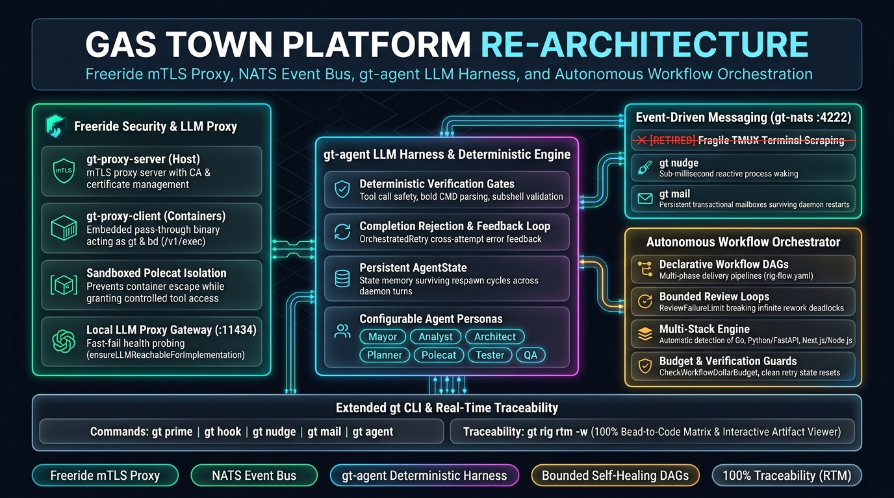
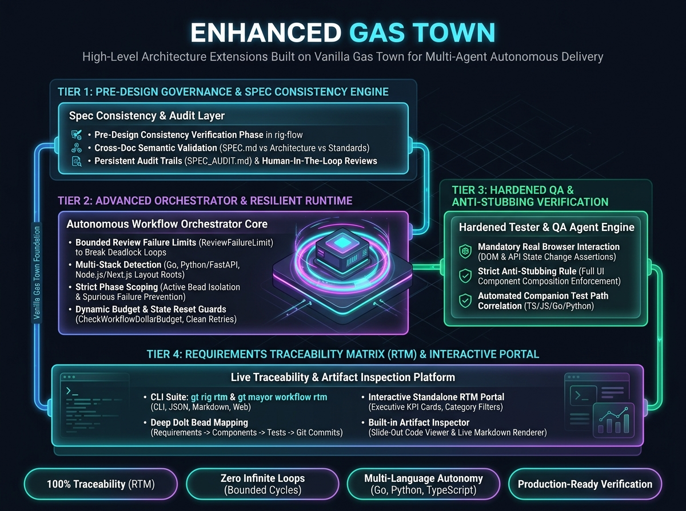

# Gas Town Platform Re-Architecture & Infrastructure Extensions

---

## 1. Architectural Transformation Overview

Vanilla Gas Town pioneered multi-agent software engineering using terminal sessions, local filesystem locks, and tmux panes. While intuitive for small manual demonstrations, production-scale autonomous delivery requires deterministic execution, reliable inter-agent messaging, strict security boundaries, and resilient workflow orchestration.

To eliminate the fragility of tmux screen scraping and uncoordinated concurrent agent execution, Gas Town has been re-architected around five foundational pillars:

1. **Freeride mTLS Reverse Proxy**: Zero-trust, secure, token-authenticated ingress and egress for all agent microservices, model routing, and API calls.
2. **NATS Messaging Bus**: Replacing tmux panes and ad-hoc file polling with a high-throughput, low-latency, event-driven pub/sub and request-reply fabric.
3. **`gt-agent` LLM Harness**: Replacing raw unconstrained shell interactions with a structured, sandboxed harness enforcing deterministic schema validation, tool sandboxing, and pre/post assertions.
4. **`gt-orchestrator` Core Engine**: A declarative execution engine that drives DAG-based workflow pipelines, manages phase transitions, and coordinates automated self-healing recovery loops.
5. **Dynamic Workflow Profiles & CLI Extensions**: Configurable agent roles (`rig-flow.yaml`, `req-flow.yaml`), automated Requirements Traceability Matrix generation (`gt rig rtm`), and comprehensive verification commands.

---

## 2. The Five Foundational Pillars

### Pillar 1: Freeride mTLS Reverse Proxy & Model Router
- **Security & Identity**: Mutual TLS (mTLS) with cryptographically validated client certificates for all intra-town communications.
- **Unified Egress & Rate Limiting**: Intercepts and audits all upstream LLM provider calls (OpenRouter, Anthropic, Gemini, OpenAI), handling token throttling, exponential backoff, circuit breaking, and secret protection.
- **Service Ingress**: Safely exposes internal agent interfaces, UI dashboards (FinAlly, LinkShelf), and RTM verification portals with zero open unauthenticated host ports.

### Pillar 2: NATS Event Fabric (Replacing TMUX)
- **Elimination of TMUX Bottlenecks**: Vanilla Gas Town relied on spawning tmux windows, sending raw keys, and scraping ANSI terminal buffers.
- **Asynchronous Pub/Sub & Request-Reply**: Agent roles (Analyst, Architect, Planner, Polecat, Tester, QA, Mayor) subscribe to typed subjects (`gastown.rig.events.*`, `gastown.agent.<name>.task`).
- **Resilient Delivery**: Guaranteed message persistence, dead-letter queuing, and heartbeating without reliance on terminal processes.

### Pillar 3: `gt-agent` Deterministic LLM Harness
- **Structured Tool Invocations**: LLM responses are parsed through verified JSON/Protobuf schemas rather than freeform command-line guessing.
- **Deterministic Pre/Post Verification**: Each agent action (creating files, executing builds, running tests) is checked against deterministic quality rules before the state is committed.
- **Failure Gating & Rollback**: When a syntax error, build break, or test assertion failure occurs, `gt-agent` captures the exact diagnostic trace and isolates the working tree.

### Pillar 4: `gt-orchestrator` & Autonomous Lifecycle
- **Declarative Pipeline Execution**: Coordinates the 7-stage software development lifecycle:
  1. *Analysis* (`SPEC.md` formulation & requirements capture)
  2. *Architecture* (Technology selection & structural design)
  3. *Planning* (Beads issue generation & dependency tracking)
  4. *Toolchain Setup* (Scaffolding, dependencies, environment validation)
  5. *Implementation* (Clean, modular code authoring)
  6. *Test Verification* (Unit, integration, and contract tests)
  7. *QA Acceptance* (End-to-end user journeys, performance checks)
- **Autonomous Recovery Engine**: In case of quality gate failures, Mayor automatically dispatches targeted remediation tasks back to the planner, tester, or implementer without human intervention.

### Pillar 5: Dynamic Configuration & Extended CLI
- **Declarative Configurations**: Rig behaviors are defined in clean YAML specifications (`rig-flow.yaml`, `req-flow.yaml`, `STANDARDS.md`, `SECURITY_STANDARDS.md`).
- **New CLI Capabilities**:
  - `gt workflow run <name>`: Execute automated end-to-end development runs.
  - `gt rig rtm`: Generate verifiable Requirements Traceability Matrix reports with interactive HTML views.
  - `gt agent test`: Execute deterministic agent harness verification suites.
  - `gt proxy status`: Monitor Freeride mTLS proxy routes, upstream health, and latency.

---

## 3. Architecture Comparison: Vanilla vs Enhanced Gas Town

| Feature / Subsystem | Vanilla Gas Town | Enhanced Gas Town Platform |
| :--- | :--- | :--- |
| **Agent Coordination** | TMUX window automation & ANSI buffer scraping | High-speed NATS event messaging bus |
| **Model Ingress/Egress** | Unmanaged direct outbound HTTP calls | Freeride mTLS reverse proxy & token guard |
| **Agent Execution Loop** | Direct shell command piping | `gt-agent` deterministic harness with checks |
| **Workflow Engine** | Fixed procedural scripts | `gt-orchestrator` DAG engine with recovery |
| **Requirements Traceability** | Static markdown checklist | `gt rig rtm` real-time interactive HTML matrix |
| **Configuration** | Hardcoded agent definitions | Declarative `rig-flow.yaml` & persona templates |
| **Resilience & Self-Healing** | Manual human unblocking | Autonomous Mayor feedback & repair loops |
