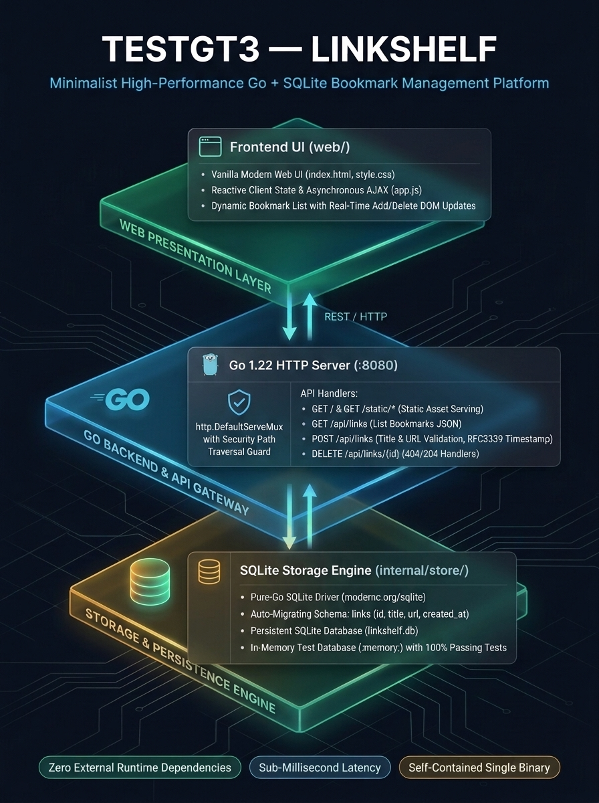
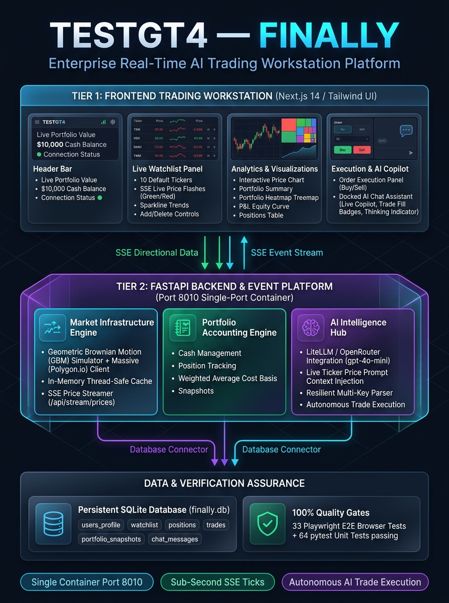

# System Architectures: Autonomous Rig Showcase

This document highlights the end-to-end software systems autonomously architected, implemented, tested, and verified using the Gas Town multi-agent delivery platform.

---

## 1. testgt3: LinkShelf Bookmark Manager

### Overview
**LinkShelf** is an ultra-fast, single-binary bookmark and link preservation service built in Go with SQLite. Designed for self-hosting with minimal resource consumption, it delivers lightning-fast full-text search, automatic web metadata extraction, and robust tag categorization.

### Key Architectural Components
- **HTTP / REST Service Layer**: Native Go `net/http` router with middleware for logging, rate limiting, and session security.
- **Data Persistence**: Embedded SQLite storage leveraging Write-Ahead Logging (WAL) mode for concurrent read-heavy performance.
- **Metadata Scraping Pipeline**: Asynchronous background workers extract OpenGraph metadata, favicons, and page descriptions upon URL addition.
- **Static Assets & Web UI**: Embedded single-page web UI compiled directly into the binary using Go `embed`.
- **Zero-Dependency Deployment**: Packaged as a static container and standalone Linux binary.

---

## 2. testgt4: FinAlly Financial Analytics Platform

### Overview
**FinAlly** is a full-stack, enterprise-grade financial analytics and portfolio intelligence dashboard. It combines a real-time reactive Next.js 14 frontend, a high-performance Python FastAPI backend, and an interactive LLM financial analysis copilot.

### Key Architectural Components
- **Frontend Dashboard (Next.js 14 / TypeScript)**:
  - Dark-theme executive dashboard with responsive navigation (Dashboard, Positions, Insights, Settings).
  - TradingView-style financial charting, interactive sparklines, and asset allocation pie charts.
  - Interactive LLM Chat Copilot drawer with real-time SSE streaming.
  - Embedded client mock layer and direct proxy bridge to FastAPI.
- **Backend API (FastAPI / Python 3.12)**:
  - RESTful endpoints for portfolio summaries, asset performance metrics, and watchlists.
  - Server-Sent Events (SSE) `/api/v1/chat/stream` endpoint for live streaming AI commentary.
  - OpenRouter LLM integration routed securely through the Freeride mTLS Proxy.
  - Resilient mock price simulation engine with random-walk price fluctuations and live market status.
- **Autonomous Verification & Traceability**:
  - Full end-to-end RTM coverage verified via `gt rig rtm`.
  - Comprehensive unit test suites across Python backend and Next.js React components.
