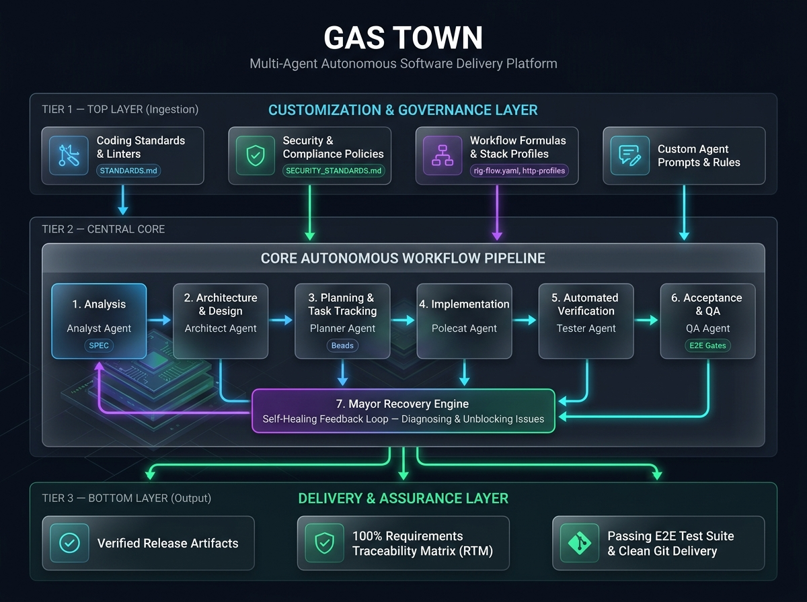
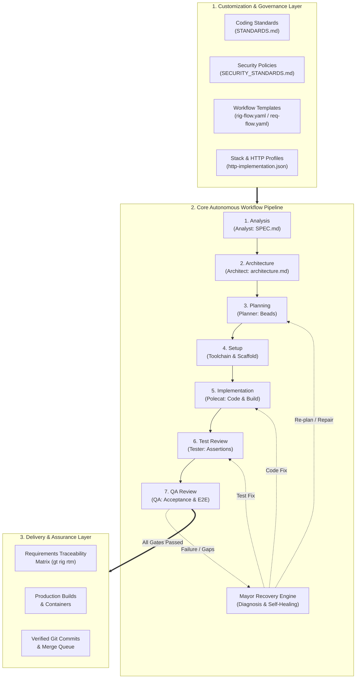

# Gas Town: Multi-Agent Autonomous Software Delivery Platform

---

## 1. Executive Summary

**Gas Town** is an orchestrated multi-agent development town designed for autonomous, end-to-end software engineering. Rather than relying on a single monolithic prompt, Gas Town coordinates specialized AI agents (Analyst, Architect, Planner, Polecat/Coder, Tester, QA, and Mayor) through structured, gated delivery pipelines with automated self-healing recovery loops.

---

## 2. Architecture & Workflow Overview

Gas Town operates on three interconnected tiers:

---

## 3. How Users Can Customize Gas Town

Gas Town is built from the ground up to be policy-driven. Users can inject organization-specific standards, security rules, tech stack constraints, and custom workflows.

### A. Custom Coding Standards (`STANDARDS.md`)
Gas Town injects coding standards into the prompt context of every coder (`polecat`), planner, and reviewer.
* **Location**: `<town_root>/STANDARDS.md` or `<town_root>/standards/`
* **What you can define**:
  * Mandatory language paradigms (e.g., idiomatic Go error handling, Python type hints, strict TypeScript).
  * Linter and formatter requirements (e.g., `golangci-lint`, `ruff`, `prettier`, `eslint`).
  * Naming conventions, folder structures, and architectural boundary constraints.
* **How agents enforce it**: Polecats check standards before closing beads; QA audits compliance during Stage 2 code quality review.

### B. Security & Compliance Policies (`SECURITY_STANDARDS.md`)
Security guidelines are treated as strict validation gates that QA and Architects evaluate.
* **Location**: `<town_root>/SECURITY_STANDARDS.md`
* **What you can define**:
  * Vulnerability prevention rules (e.g., parameterized SQL queries, sanitizing HTML inputs against XSS).
  * Secrets management (e.g., strictly prohibiting hardcoded tokens; enforcing environment variable templates).
  * Network security (e.g., CORS whitelisting, IMDSv2, secure TLS headers).
  * Container security (non-root container execution, minimal distroless base images).

### C. Technology Stack & HTTP Profiles (`http-implementation.json`)
Gas Town adapts to your web stack without code modifications.
* **Location**: `<town_root>/orchestrator/http-profiles/<stack>.json` or rig-specific override in `<rig>/mayor/rig/`
* **What you can define**:
  * Port configurations and dev-server startup commands.
  * Static vs dynamic asset routing rules.
  * Healthcheck and readiness probe paths (`/api/health`, `/healthz`).
  * Framework-specific bypasses for build artifacts (Next.js, Vite, FastAPI, Go standard library).

### D. Workflow Templates (`rig-flow.yaml` / `req-flow.yaml`)
You can define custom multi-agent execution lifecycles.
* **Location**: `<town_root>/orchestrator/templates/`
* **Customization options**:
  * Define new pipeline states and valid state transitions.
  * Specify which model runs each role (e.g., Claude 3.5 Sonnet for Architect, Haiku or DeepSeek for rapid Polecat coding).
  * Attach custom `pre_run` hooks and quality gates (`qa_verify_command`, Playwright E2E suites).

### E. Custom Role Prompts (`prompts/`)
Every agent role has a clear behavioral contract in Markdown.
* **Location**: `<town_root>/orchestrator/prompts/<template>/`
* **Customization options**:
  * Modify `polecat.md` to enforce test-driven development (TDD).
  * Customize `qa_review.md` to alter acceptance thresholds or interactive browser test strictness.
  * Tailor `analyst.md` to match your company's product requirement document (PRD) format.

---

## 4. Key Advantages

1. **Self-Healing Recovery**: If QA or the Tester detects a defect, the **Mayor Recovery Engine** diagnoses the root cause, reopens the exact affected bead, and loops back without stalling human engineers.
2. **Deterministic Verification**: Code is never marked complete based on LLM claims; it must compile, pass automated unit tests, and satisfy real browser interactions.
3. **Executive Visibility**: The **Requirements Traceability Matrix (`gt rig rtm <rig> --summary`)** provides instant 100% audit proof connecting requirements, beads, tests, and deployment assets.

---

## 5. Architectural Deep Dives & Rig Showcases

For detailed technical deep dives and architectural diagrams, see:
- [Platform Re-Architecture & Infrastructure Extensions](platform-rearchitecture.md): Replacing TMUX with NATS, introducing the `gt-agent` LLM harness, `gt-orchestrator`, and Freeride mTLS reverse proxy.
- [Autonomous System Architectures Showcase](system-architectures.md): Real-world production architectures delivered by Gas Town rigs (LinkShelf bookmark manager and FinAlly financial intelligence platform).

